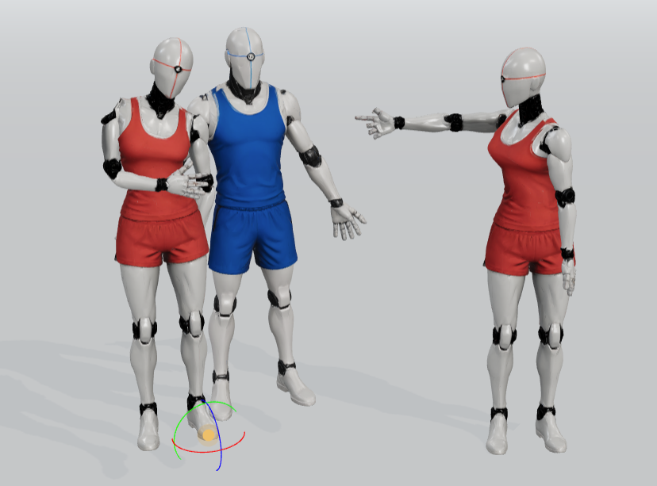
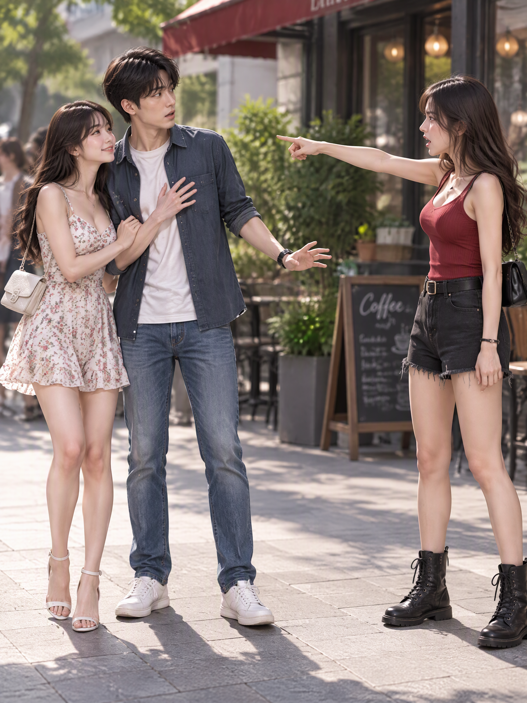
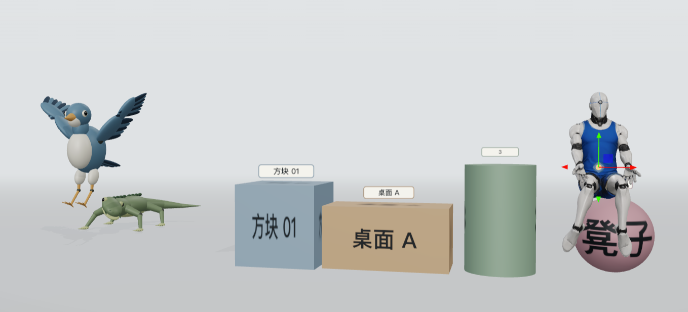
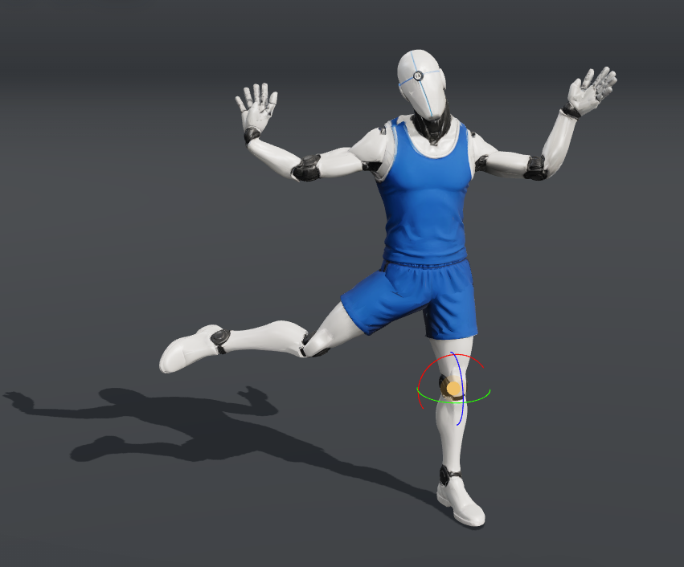
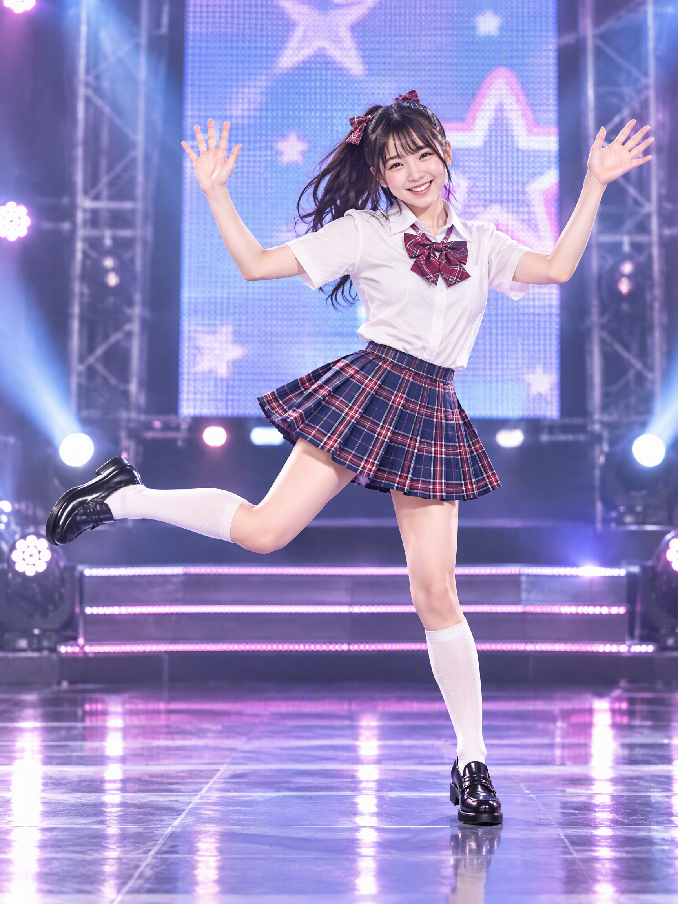
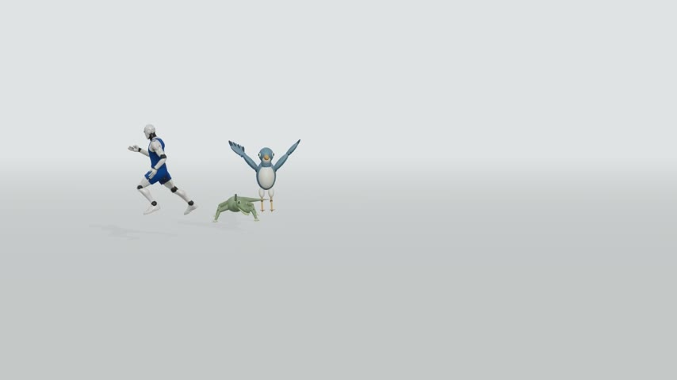
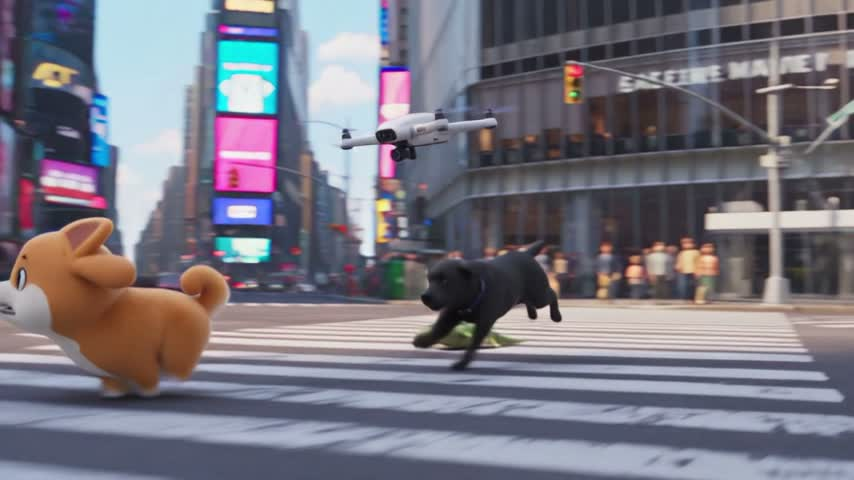

# 码上动 · 三维动作创作工作台

码上动是一个在浏览器中运行的三维动作创作工具，可以把人物、动物和基础物品放进同一场景，通过摆姿、定格、走跑衔接与录制，编排并导出动作画面。

本项目仓库：[huangama666/mashangdong](https://github.com/huangama666/mashangdong)。

## 创作案例

以下案例由用户提供，展示三维摆姿、场景编排和动作录制在创作流程中的应用。左侧为工作台中的参考，右侧为外部制作的效果示例；码上动本身不内置图像或视频生成功能。

### 图片案例

#### 1. 多人互动与情节构图

通过三位角色的位置、朝向和手臂姿势，安排人物之间的互动关系，为剧情画面提供构图参考。

<table>
  <tr><th width="50%">三维姿势参考</th><th width="50%">效果示例</th></tr>
  <tr>
    <td valign="top"><a href="docs/examples/character-interaction-reference.png"></a></td>
    <td valign="top"><a href="docs/examples/character-interaction-result.png"></a></td>
  </tr>
</table>

#### 2. 人物、动物与物品的场景编排

将人物、爬行动物、飞行动物与带名称的基础物品放进同一场景，用体块、标记与姿势表达座位、桌面及道具的位置关系。

<table>
  <tr><th width="50%">三维场景参考</th><th width="50%">效果示例</th></tr>
  <tr>
    <td valign="top"><a href="docs/examples/scene-composition-reference.png"></a></td>
    <td valign="top"><a href="docs/examples/scene-composition-result.png"></a></td>
  </tr>
</table>

#### 3. 舞蹈姿势与动作参考

调整手臂、躯干和腿部关节，保存单腿抬起、双手举起的姿势，为舞台人物创作提供动作参考。

<table>
  <tr><th width="50%">三维姿势参考</th><th width="50%">效果示例</th></tr>
  <tr>
    <td valign="top"><a href="docs/examples/dance-pose-reference.png"></a></td>
    <td valign="top"><a href="docs/examples/dance-pose-result.png"></a></td>
  </tr>
</table>

### 视频案例

#### 动作与运镜参考 → 动画效果

左侧是在工作台中录制的人物、蜥蜴与鸟的动作参考；右侧为外部制作的城市追逐动画效果。此案例展示将参考视频的动作与镜头用于后续创作，并替换角色及场景的使用方式。

点击封面进入对应视频文件页，下载原始 MP4 后即可播放。

| 工作台动作参考 · 约 6 秒 | 动画效果示例 · 约 6 秒 |
| --- | --- |
| [](docs/examples/motion-reference.mp4) | [](docs/examples/motion-result.mp4) |
| [视频文件](docs/examples/motion-reference.mp4) · [下载 MP4](https://github.com/huangama666/mashangdong/raw/refs/heads/main/docs/examples/motion-reference.mp4) | [视频文件](docs/examples/motion-result.mp4) · [下载 MP4](https://github.com/huangama666/mashangdong/raw/refs/heads/main/docs/examples/motion-result.mp4) |

## 主要功能

- **人物与动物**：男性、女性、小孩，以及爬行动物、飞行动物可同框编辑，提供关节选择、姿势预设、缩放、复制与保存。
- **关节摆姿**：人物支持 IK 拖拽与 FK 调整；动物使用 FK 关节，可调整四肢、翅膀和尾巴等部位。
- **基础物品**：提供正方体、长方体、圆柱体和圆球，支持数字或名称标记、颜色、位置与旋转编辑。
- **尺寸调整**：支持数值输入和尺寸手柄；长方体可分别调宽高深，圆柱体可调直径和高度，正方体与圆球保持等比。
- **同一条动画轨道**：定格与录制片段共同排序、预览和导出，支持替换定格、移动片段、删除及撤销。
- **逐帧独立设置**：每张定格分别保存停留时间、衔接方式和到下一帧的过渡时间。
- **走跑衔接**：发生位移的人物或动物可分别选择按定格、走过去或跑过去，到达后恢复目标定格的姿势。
- **录制与导出**：录制拖动操作后自动入轨；支持整轨视频合成与 PNG 图片导出。视频使用 1280 × 720、目标 30 fps，不含声音。
- **统一取景**：新定格保存镜头，新录制与定格共用 16:9 取景和预览区域。
- **工作台界面**：带文字的工具栏、可收起的属性区、选中帧参数区，以及适合窄屏的属性抽屉和播放控制。

## 动物类别与代表模型

- **爬行动物（蜥蜴）**：当前以蜥蜴作为爬行动物的代表模型，支持四肢、颈部、头部与分段尾巴的关节摆姿，以及慢爬、快爬衔接。
- **飞行动物（鸟）**：当前以鸟作为飞行动物的代表模型，支持翅根、翼尖、尾羽、颈部与腿脚的关节摆姿，并提供展翅、振翅和降落姿势。

这里的「爬行动物」「飞行动物」是界面中的角色类别，蜥蜴和鸟是当前提供的代表模型，尚未包含每个类别的所有物种。走跑衔接中的鸟使用地面迈步；展翅等飞行预设为可编辑的静态姿势，不代表已经具备自动飞行路径。

## 本机启动

推荐使用 Node.js 22.12 或更高版本。

### macOS

在访达中双击 `启动.command`。脚本会安装缺少的依赖、构建最新页面，并打开：

http://127.0.0.1:4173/

如果服务已运行，脚本会先更新构建再打开页面。脚本不会结束占用端口的其他项目。

也可以在项目目录执行：

```sh
npm ci
npm run build
npm run preview -- --strictPort
```

### Windows

双击 `启动.bat` 启动开发服务，默认地址为 http://127.0.0.1:5173/ 。

## 开发与验证

```sh
# 开发服务；若默认端口被占用，可指定其他端口
npm run dev -- --port 5174 --strictPort

# 自动测试
npm test

# 生成部署文件
npm run build
```

构建结果位于 `dist/`，部署时需保留其中的 `assets/` 与 `models/` 目录。

## 基本操作

1. 从顶部添加角色或物品，在右侧属性区调整姿势、尺寸和标记。
2. 打开「定格 / 录制」，用「定格当前画面」保存动作，或录制拖动后自动加入轨道。
3. 选中定格，设置本帧停留、到下一帧的衔接方式及人物、动物的走跑选项。
4. 预览整条轨道，完成后导出视频；展开结果条即可查看与下载。

拖动空白处旋转视角，右键平移，滚轮缩放。「适配画面」可框选全部对象，右上角「属性」可收起编辑面板。详细说明见 [运行说明.md](运行说明.md)。

## 数据与兼容

场景、保存的姿势和轨道元数据保存在当前浏览器的本地存储中，录制视频保存在 IndexedDB。不同浏览器或访问地址的存储相互独立；清除网站数据会删除本地保存内容，请及时下载重要视频和图片。

更名保留旧版存储标识，以兼容已有场景与录制。旧视频中的取景已固定，需重新录制才能使用统一的新取景；旧定格可通过「替换选中定格」保存当前镜头。

## 代码结构

| 路径 | 用途 |
| --- | --- |
| `src/main.js` | 三维场景、交互、编辑与界面连接 |
| `src/humanModel.js`、`src/animalModel.js` | 人物与动物模型 |
| `src/propModel.js` | 基础物品、标记与尺寸 |
| `src/motionStudio.js`、`src/timeline.js` | 定格、录制与动画轨道 |
| `src/motionMedia.js`、`src/clipStore.js` | 取景、视频入轨与本地存储 |
| `src/locomotion.js` | 人物与动物的走跑衔接 |
| `src/style.css`、`src/workbench.css` | 界面样式与响应式布局 |
| `public/models/` | 人物模型资源 |
| `tests/` | 自动测试 |
